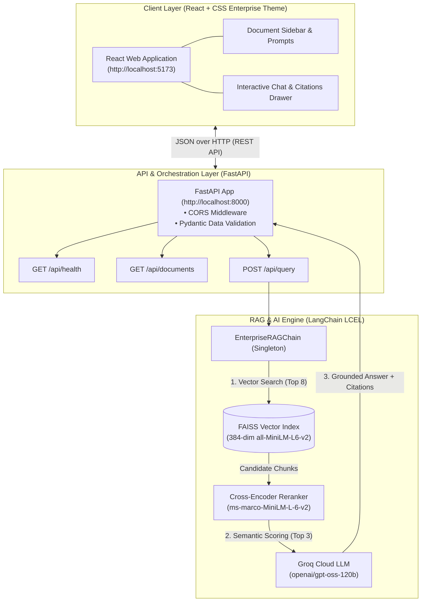

# 🏢 Enterprise Knowledge Assistant (Fullstack RAG)

An enterprise-grade **Retrieval-Augmented Generation (RAG)** application designed to ingest, index, and query corporate policy documents with high precision. Built with a **React + Vite** frontend (corporate theme), a **FastAPI** backend, and a **LangChain (LCEL)** AI engine featuring **FAISS**, **Hugging Face Sentence Transformers**, **Cross-Encoder Re-ranking**, and **Groq LLM**.

---

## 🏗️ End-to-End System Architecture



---

## 📁 Full Project Structure

```text
Enterprise-Knowledge-Assistant-Rag/
├── data/
│   └── raw/                                 # 11 Enterprise PDF Policies & Handbooks
├── faiss_index/                             # Persisted FAISS vector database
├── frontend/                                # Modern React + Vite Application
│   ├── src/
│   │   ├── App.jsx                          # Main chat interface, sidebar & citations drawer
│   │   ├── App.css                          # Enterprise theme styling (navy/slate/glass)
│   │   ├── index.css                        # Design tokens, typography & scrollbars
│   │   └── main.jsx                         # React DOM root entry
│   ├── package.json                         # Dependencies (react, lucide-react, vite)
│   ├── vite.config.js                       # Vite server configuration
│   └── index.html                           # App shell with Inter & JetBrains Mono fonts
├── src/
│   └── knowledge_assistant/
│       ├── Ingestion/
│       │   ├── document_loader.py           # Loads PDFs into LangChain documents
│       │   ├── chunking.py                  # Splits documents into semantic chunks
│       │   └── vector_store.py              # Computes embeddings & saves FAISS index
│       ├── api.py                           # FastAPI application endpoints
│       └── rag_chain.py                     # LCEL RAG Chain + Cross-Encoder Re-ranker + Groq
├── run_project.bat                          # 1-Click launcher for Windows CMD
├── run_project.ps1                          # 1-Click launcher for PowerShell
├── RUN_COMMANDS.md                          # Complete Interview & Command Cheat Sheet
├── .env                                     # Environment secrets (GROQ_API_KEY)
├── .gitignore                               # Protects .env, vector index, and cache files
└── README.md
```

---

## 🔌 API Endpoints Reference

| Method | Endpoint | Description | Sample Response |
| :--- | :--- | :--- | :--- |
| **`GET`** | `/api/health` | Verifies server status and FAISS readiness | `{"status": "healthy", "rag_ready": true, "groq_model": "openai/gpt-oss-120b"}` |
| **`GET`** | `/api/documents` | Lists all indexed policy documents and sizes | `[{"filename": "code-of-conduct.pdf", "size_kb": 13.28}, ...]` |
| **`POST`** | `/api/query` | Submits question to LCEL RAG pipeline with live online evals and LLMOps tracing | `{"question": "...", "answer": "...", "sources": [...], "trace_id": "...", "latency_seconds": 0.82}` |
| **`GET`** | `/api/llmops/metrics` | Retrieves aggregated telemetry, token spend, latency breakdown, and trace log | `{"total_queries": 12, "avg_latency_seconds": 0.78, "satisfaction_rate": "95%", ...}` |
| **`POST`** | `/api/llmops/feedback` | Records Human-in-the-Loop feedback (thumbs_up / thumbs_down) linked to trace | `{"success": true, "trace_id": "..."}` |

---

## 📊 Enterprise LLMOps, Distributed Tracing & Online Evals

The system includes a dedicated, production-grade LLMOps observability layer:

1. **Distributed Tracing (`trace_id`)**: Every query generates an RFC-4122 compliant UUID attached to all retrieval, re-ranking, LLM generation, and evaluation logs.
2. **Granular Stage Latency Breakdown**:
   - `retrieval_ms`: Vector search across 384-dimensional FAISS embeddings.
   - `rerank_ms`: Cross-Encoder logit scoring (`ms-marco-MiniLM-L-6-v2`).
   - `llm_generation_ms`: Groq enterprise LPU inference (`gpt-oss-120b`).
   - `eval_ms`: Live calculation of Groundedness, Retrieval Confidence, and Hallucination Risk.
3. **Token Accounting & Cost Economics**:
   - Accurately tracks prompt and completion tokens.
   - Computes dollar spend using Groq enterprise rates ($0.00059/1k prompt, $0.00079/1k completion).
   - Re-ranking token pruning delivers **~70% cost reduction** compared to raw multi-chunk injection.
4. **Human-in-the-Loop (HITL) Feedback**:
   - Thumbs-up / thumbs-down buttons embedded directly in each response card.
   - Automatically computes live user satisfaction rates in the Observability Command Center.
5. **Real-Time Online Evaluation**:
   - Groundedness & Faithfulness Scoring (lexical containment + semantic entailment).
   - Sigmoid-transformed Retrieval Probability.
   - Dynamic Low / Moderate / High Hallucination Risk Tiering.


---

## 🚀 Running the Fullstack Application

To run the complete application, open **two terminal windows**:

### Terminal 1: Start FastAPI Backend
```powershell
& "$env:LOCALAPPDATA\Programs\Python\Python310\python.exe" -m uvicorn src.knowledge_assistant.api:app --host 127.0.0.1 --port 8000 --reload
```
*Backend will be running at:* `http://127.0.0.1:8000`  
*Interactive Swagger API Docs:* `http://127.0.0.1:8000/docs`

### Terminal 2: Start React Frontend
```powershell
cd frontend
npm run dev
```
*Frontend will be running at:* `http://localhost:5173`

Open `http://localhost:5173` in your browser to interact with your Enterprise Knowledge Assistant!
